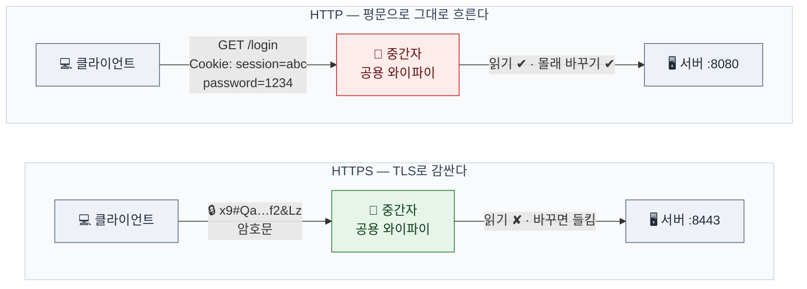
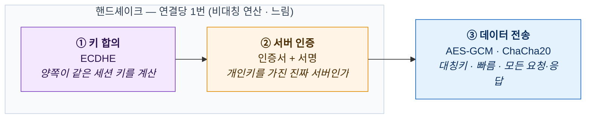
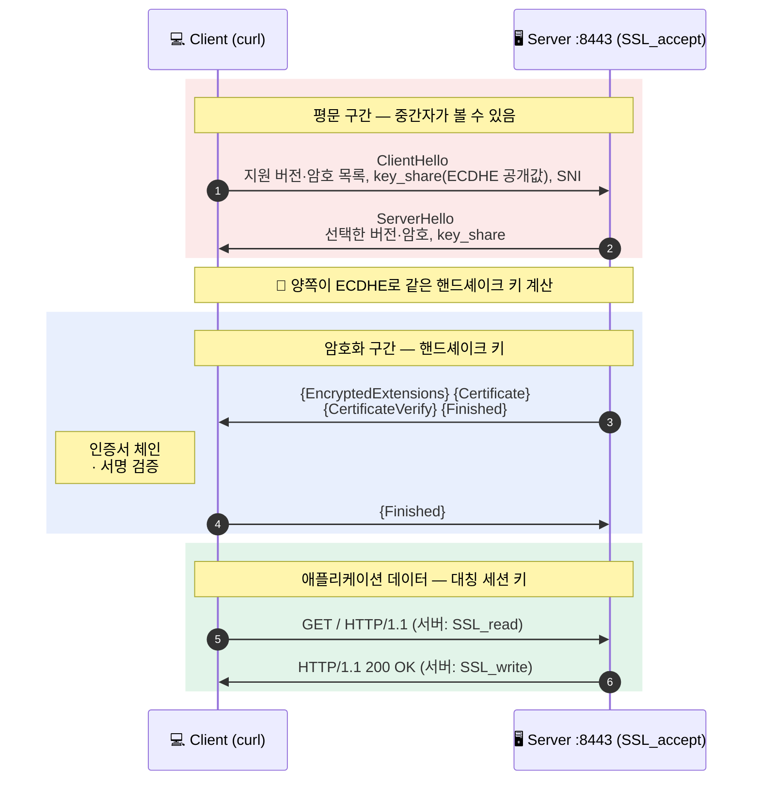
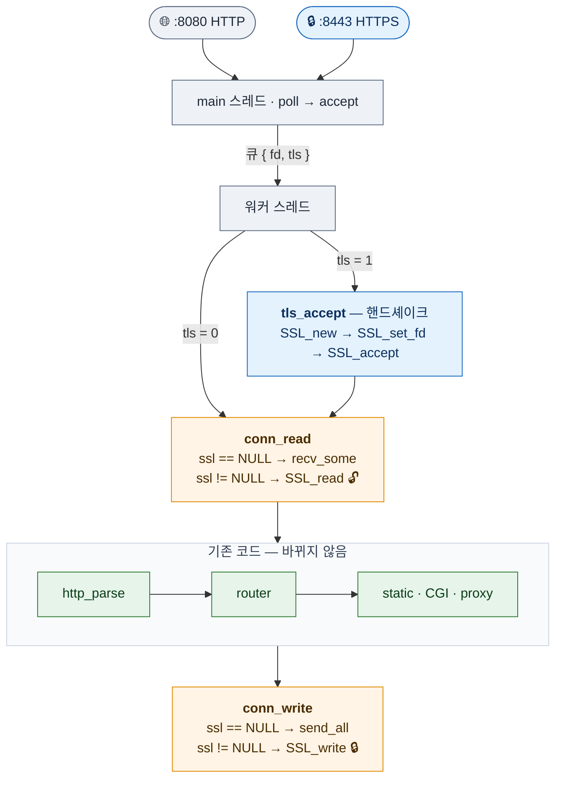
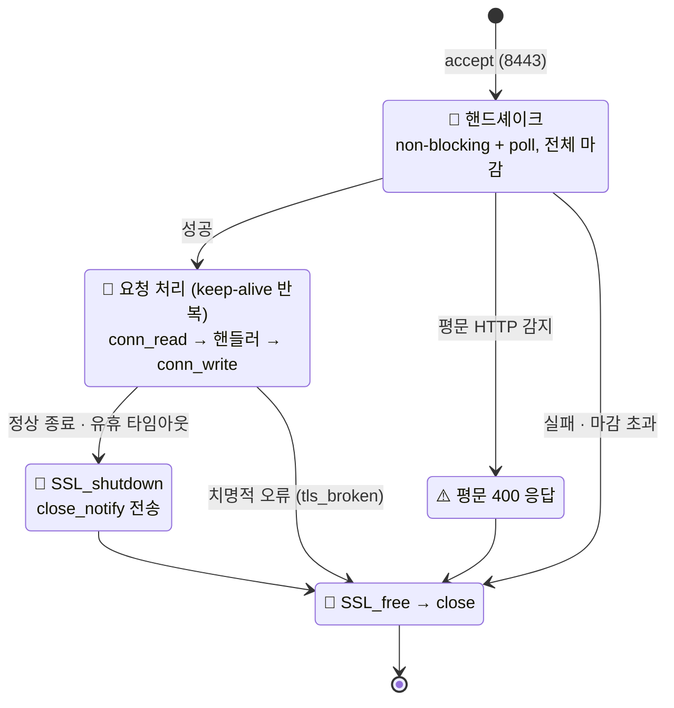
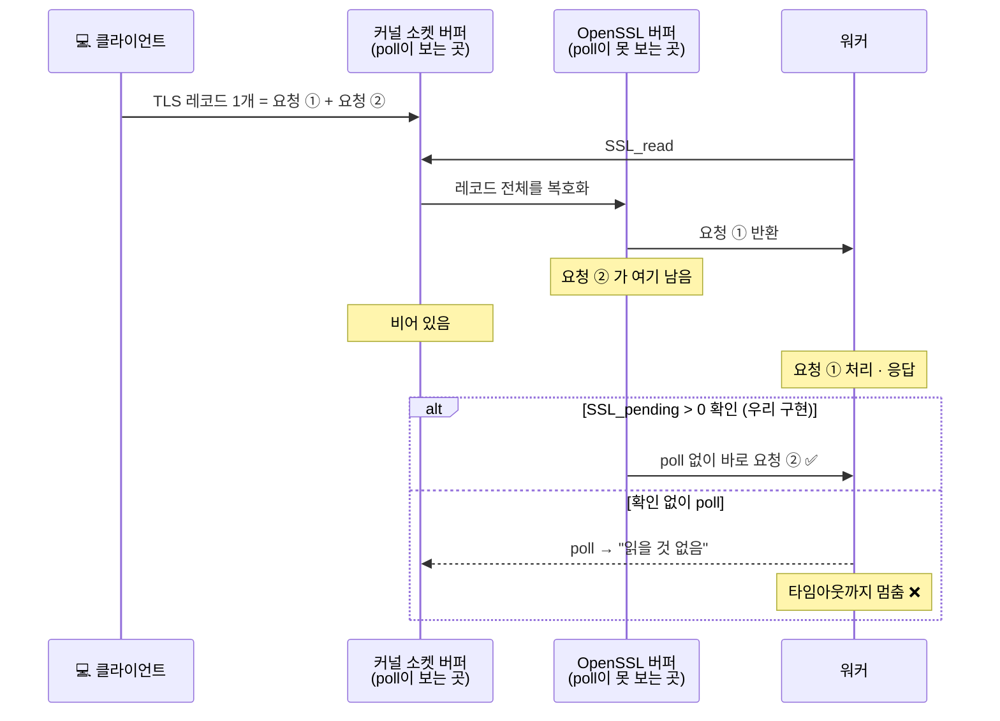
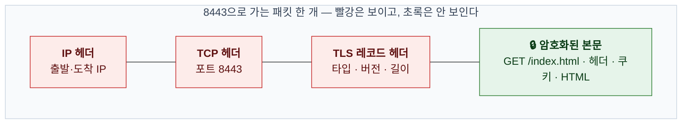
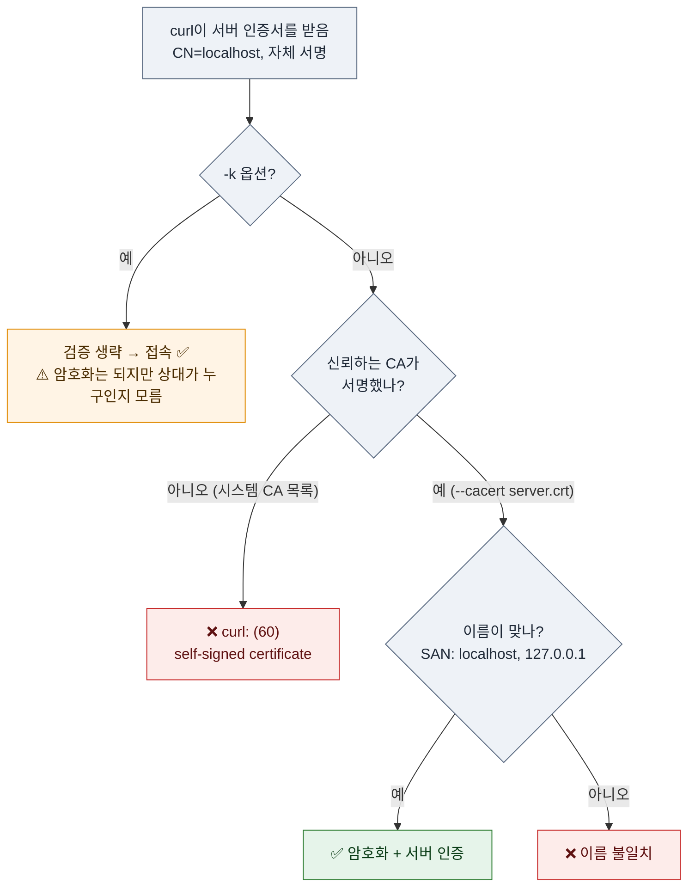
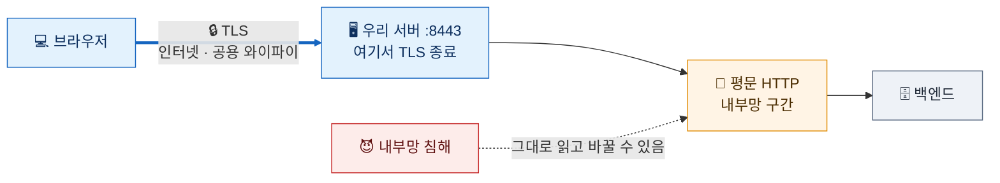
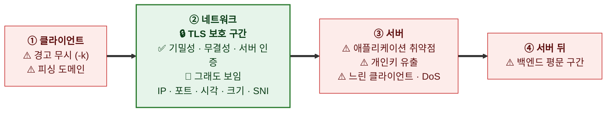

# HTTPS는 정말 안전할까?

> C로 만든 웹 서버(`threadpool/`)에 OpenSSL로 TLS를 붙여 보며, HTTPS가 **무엇을 지켜 주고 무엇을 지켜 주지 못하는지** 확인한 기록입니다.
> 구현 세부는 [`DESIGN.md` 17절](DESIGN.md#17-https-tls--스레드-풀-판-tls-connio), 전체 서버 설명은 [루트 README](../README.md)에 있습니다.

## Quick Start (빌드 · 인증서 생성 · 실행)

필요한 것: OpenSSL **1.1.0 이상** (macOS `brew install openssl@3`, Ubuntu `apt install libssl-dev`)

```sh
cd threadpool
make            # build/release/webserver (OpenSSL 경로는 Makefile 이 pkg-config → Homebrew 순으로 찾음)
make cert       # 자체 서명 인증서 → certs/server.crt, certs/server.key  (= bash tools/gen-cert.sh certs)

# HTTP 8080 + HTTPS 8443 동시 수신
./build/release/webserver -r ../examples/www -C certs/server.crt -K certs/server.key
```

```sh
curl http://localhost:8080/                              # 평문 HTTP
curl -k https://localhost:8443/                          # HTTPS (자체 서명이라 검증 생략)
curl --cacert certs/server.crt https://localhost:8443/   # 이 인증서를 신뢰 → 검증 성공
```

---

## 1. Introduction — 문제 제기, HTTP vs HTTPS

**문제 제기.** 주소창의 자물쇠는 정확히 *무엇이* 안전하다는 뜻일까요? 우리 서버에 TLS를 붙이고, 패킷을 떠 보고, 일부러 실패시켜 보며 확인했습니다.

| | HTTP | HTTPS |
|---|---|---|
| 전송 | TCP 위에 평문 | TCP 위에 **TLS**, 그 위에 HTTP |
| 기본 포트 | 80 (우리 서버 8080) | 443 (우리 서버 8443) |
| 중간자가 내용을 볼 수 있나 | 예 (요청줄, 헤더, 쿠키, 본문 전부) | 아니오 (암호문만 보임) |
| 중간자가 내용을 바꿀 수 있나 | 예 (들키지 않고) | 패킷 변조·연결 끊기는 가능하지만, 무결성 검사에서 걸려 **변조된 내용이 정상 데이터로 전달되지는 않음** |
| 상대가 진짜 그 서버인가 | 확인 수단 없음 | 인증서로 확인 |



<!-- TODO: 발표용 한 줄 질문 / 동기(예: 공용 와이파이) -->

## 2. Understanding TLS — 암호화·인증, 대칭/비대칭키

TLS가 주는 세 가지:

| 성질 | 의미 | 수단 |
|---|---|---|
| 기밀성 | 엿봐도 못 읽는다 | 대칭키 암호 (AES-GCM, ChaCha20-Poly1305) |
| 무결성 | 바꾸면 들킨다 | AEAD의 인증 태그 |
| 인증 | 상대가 진짜 그 서버다 | 인증서 + 서명 (비대칭키) |

**대칭키 vs 비대칭키**

| | 대칭키 | 비대칭키 |
|---|---|---|
| 키 | 암호화·복호화에 같은 키 | 공개키 / 개인키 쌍 |
| 속도 | 빠름 (대량 데이터에 적합) | 느림 |
| TLS에서의 역할 | 실제 데이터 암호화 | 서버 인증(서명), 키 교환 |

→ TLS는 둘을 섞습니다. **인증서와 비대칭키 서명으로 서버를 인증하고, ECDHE로 대칭 세션 키를 합의한 뒤, 실제 데이터는 대칭키로 암호화**합니다.
(일반적인 HTTPS는 서버만 인증합니다. mTLS를 쓰면 클라이언트도 인증서로 인증할 수 있습니다.)



**인증서와 CA.** 인증서는 "이 공개키의 주인은 `localhost`다"라는 문서에 CA가 서명한 것이고, 클라이언트는 자기가 믿는 CA 목록으로 이를 검증합니다.
우리 인증서는 **자체 서명**이라 어떤 CA도 보증하지 않습니다(5절의 검증 실패 데모).

## 3. TLS Handshake

TLS 1.3 기준 (1-RTT):



- **키 교환**: ECDHE. 매 연결마다 새 키를 만들어 개인키가 나중에 털려도 과거 트래픽은 안전합니다(전방 비밀성).
- **인증**: `CertificateVerify`는 서버 개인키로 한 서명입니다. 인증서의 공개키로 검증되면 "개인키를 가진 진짜 서버"입니다.
- **우리 서버**: `SSL_accept` 한 번이 이 과정 전체를 처리합니다. `openssl s_client`로 협상 결과를 볼 수 있습니다(5절).

<!-- TODO: TLS 1.2 와의 차이 (2-RTT, RSA 키 교환 제거) 필요하면 추가 -->

## 4. Implementation — 아키텍처, OpenSSL 적용, 주요 함수

### 아키텍처: TLS는 클라이언트 I/O 경계 한 곳에만

기존 서버에 **TLS 계층만 추가**했습니다. 파서, 라우터, 정적 파일·CGI·프록시 핸들러는 그대로이고,
소켓을 읽고 쓰는 곳만 `conn_read` / `conn_write`로 바뀌었습니다.



| 단계 | HTTP (8080) | HTTPS (8443) |
|---|---|---|
| 연결 시작 | 없음 | 워커: `SSL_new` → `SSL_set_fd` → `SSL_accept` |
| 요청 읽기 | `recv_some` | `conn_read` = (`SSL_pending`이 0이면 poll) + `SSL_read` |
| 파싱·라우팅 | `http_parse` → `router` → 핸들러 | 같음 |
| 응답 쓰기 | `send_all` | `SSL_write` (레코드 ≤16KB, 반복) |
| 닫기 | `shutdown` → `close` | `SSL_shutdown`(close_notify) → `SSL_free` → `shutdown` → `close` |

**HTTPS 연결 하나의 생애** — 어느 경로로 끝나든 `SSL_free` → `close`로 모입니다(누수 없음, valgrind로 확인).



### OpenSSL 적용

- 빌드: `-isystem <prefix>/include`, `-DOPENSSL_API_COMPAT=0x10100000L`, `-lssl -lcrypto`
- `connio.h`는 OpenSSL 헤더를 include하지 않습니다(`struct ssl_st *` 불완전 타입). 핸들러는 OpenSSL을 몰라도 컴파일됩니다.
- 설정: TLS 1.2 이상만, 재협상 금지(`SSL_OP_NO_RENEGOTIATION`), `SSL_MODE_AUTO_RETRY`

### 주요 함수

| 함수 (파일) | 하는 일 | OpenSSL 함수 |
|---|---|---|
| `tls_ctx_create` (`tls.c`) | 시작 시 SSL_CTX 하나. TLS 1.2 하한, 인증서·키 등록, 짝 검증 | `SSL_CTX_new`, `SSL_CTX_set_min_proto_version`, `SSL_CTX_use_certificate_chain_file`, `SSL_CTX_use_PrivateKey_file`, `SSL_CTX_check_private_key` |
| `tls_accept` (`tls.c`) | 연결마다 핸드셰이크. 이때만 non-blocking + poll로 전체 마감을 지킴. 평문 HTTP 감지 | `SSL_new`, `SSL_set_fd`, `SSL_accept`, `SSL_get_error` |
| `conn_read` (`connio.c`) | 복호화해 읽기. `SSL_pending`을 먼저 확인 | `SSL_pending`, `SSL_read` |
| `conn_write` (`connio.c`) | 암호화해 전부 쓰기 | `SSL_write` |
| `tls_io_fail` (`tls.c`) | 실패를 EOF / 타임아웃 / 오류로 분류하고 로그 | `SSL_get_error`, `ERR_peek_error` |
| `tls_close` (`tls.c`) | close_notify 후 해제 (치명적 오류 뒤에는 생략) | `SSL_shutdown`, `SSL_free` |

**구현하며 부딪힌 점** (자세히는 DESIGN.md 17절)
- **`SSL_pending`**: 복호화된 바이트는 OpenSSL 안에 남아 poll에 안 보입니다. 확인하지 않으면 파이프라이닝된 두 번째 요청이 타임아웃까지 멈춥니다.
- **핸드셰이크 마감**: blocking `SSL_accept`는 수신마다 타임아웃이 다시 시작돼, 1바이트씩 보내는 클라이언트를 못 막습니다.
- **CGI**: 출력을 파이프로 모아 `conn_write`로 보내므로 그대로 암호화됩니다. stdout을 소켓에 `dup2`했다면 TLS를 우회했을 겁니다.

**`SSL_pending`이 왜 필요한가** — 파이프라이닝된 두 요청이 한 TLS 레코드로 올 때:



## 5. Demo — 패킷 비교, s_client, 인증서 검증 실패

### 5-1. 패킷 비교: 같은 요청을 8080과 8443으로

```sh
# 터미널 1 (macOS 루프백: lo0, Linux: lo)
sudo tcpdump -i lo0 -A 'tcp port 8080 or tcp port 8443'

# 터미널 2
curl http://localhost:8080/index.html
curl -k https://localhost:8443/index.html
```

- 8080: `GET /index.html HTTP/1.1`, 헤더, HTML 본문이 그대로 보입니다.
- 8443: 일반적인 TLS 설정에서는 ClientHello의 SNI 등 일부 메타데이터가 평문으로 보일 수 있지만, 핸드셰이크 이후의 HTTP 요청·응답 내용은 읽을 수 없습니다.
  IP, 포트, 접속 시각, 트래픽 크기도 여전히 보입니다(7절 "메타데이터").



<!-- TODO: 캡처 이미지 / Wireshark 화면 -->

### 5-2. `openssl s_client`로 핸드셰이크 보기

```sh
openssl s_client -connect localhost:8443 -servername localhost
```

확인할 것: 인증서 체인(`subject=CN=localhost`), 협상된 버전(`TLSv1.3`)과 암호, `Verify return code`.

```sh
openssl s_client -connect localhost:8443 -tls1_1   # 서버가 TLS 1.1 거부 → 핸드셰이크 실패
```

### 5-3. 인증서 검증 실패

```sh
curl https://localhost:8443/          # curl: (60) SSL certificate problem: self-signed certificate
curl -k https://localhost:8443/       # 검증 생략 → 성공 (암호화는 되지만 상대가 누구인지 모름)
curl --cacert certs/server.crt https://localhost:8443/   # 이 인증서를 신뢰 → 성공
curl http://localhost:8443/           # HTTPS 포트에 평문 → 400 (서버는 계속 동작)
```



→ `-k`는 **암호화는 하지만 인증은 포기**한 상태입니다. 중간자가 자기 인증서를 내밀어도 그대로 접속됩니다.

## 6. Our HTTPS Server vs Production HTTPS

| 항목 | 우리 서버 | 실제 서비스 (nginx, CDN 등) |
|---|---|---|
| 인증서 | 자체 서명 (`make cert`) | 공인 CA 발급 (Let's Encrypt 등), 자동 갱신 |
| 도메인별 인증서 (SNI) | 인증서 하나 | SNI로 도메인마다 다른 인증서 |
| 프로토콜 | TLS 1.2+ / HTTP/1.1 | TLS 1.2+ / ALPN으로 HTTP/2·HTTP/3 |
| 백엔드 연결 | 프록시 → 백엔드는 **평문** | 내부망도 TLS(mTLS)인 경우가 많음 |
| 동시성 | 연결당 워커 하나, 데이터 단계 blocking | 이벤트 루프 + non-blocking TLS |
| 성능 최적화 | 없음 | 세션 재개, OCSP stapling, 하드웨어 가속 |
| 브라우저 강제 | 없음 | HSTS (HTTP로 다운그레이드 방지) |
| 같은 점 | 암호·프로토콜은 검증된 라이브러리(OpenSSL)에 맡김, TLS 1.2 하한, 재협상 금지 | |

<!-- TODO: 실제 사이트 s_client 결과와 나란히 비교 -->

### Q. 꼭 필요한 정보만 TLS로 보호하면 더 빠르지 않을까?

보통은 **전체 연결을 TLS로 보호하는 편이 더 안전하고 관리하기도 쉽습니다.**

- **TLS는 암호화만 하는 게 아닙니다.** 기밀성 외에 무결성과 서버 인증도 줍니다. 공개 데이터(뉴스, 스크립트, 다운로드 파일)라도 평문으로 보내면 중간자가 내용을 바꾸거나 악성 스크립트를 끼워 넣을 수 있습니다.
- **선택적 보호는 경계를 복잡하게 만듭니다.** 무엇이 민감한지 매번 판단해야 하고, 평문 페이지가 HTTPS 페이지로 가는 링크를 바꾸거나 쿠키가 평문 요청에 실려 새는 등 실수할 여지가 큽니다.
- **비용은 생각보다 작습니다.** 비싼 부분은 핸드셰이크인데, 세션 재사용, 연결 재사용(keep-alive), AES 하드웨어 가속 덕분에 일반적인 웹 서비스에서는 부담이 크지 않습니다.
- **"TLS 종료 후 평문"은 실제로 쓰이는 절충입니다.** 위 표의 "백엔드 연결"처럼 프록시에서 TLS를 끝내고 내부 백엔드 구간은 평문으로 둘 수 있습니다(우리 서버의 리버스 프록시가 이렇습니다). 다만 내부망이 침해되면 그 구간이 그대로 노출되므로, 실제 서비스는 내부망에도 TLS(mTLS)를 쓰는 경우가 많습니다.



## 7. TLS가 지키지 못하는 것 — 한계와 대응

TLS는 **전송 구간**을 지킵니다. 그 밖은 지켜 주지 않습니다.



| 지키지 못하는 것 | 왜 | 대응 | 우리 서버 사례 |
|---|---|---|---|
| 메타데이터 | IP, 포트, 접속 시각, 트래픽 크기는 보임. SNI도 평문 | ECH(Encrypted Client Hello), VPN/Tor | `tcpdump`에서 8443 접속 자체와 크기는 보임 (5-1) |
| 인증 무시 | 사용자가 경고를 넘기거나 `-k`를 쓰면 중간자 공격에 열림 | 인증서 검증 강제, HSTS, 인증서 고정 | `curl -k`는 누구에게 접속했는지 모름 (5-3) |
| 피싱 사이트 | 공격자도 자기 도메인 인증서를 정상 발급받음. 자물쇠 = "이 도메인과 암호화됨"일 뿐 | 도메인 확인, CT 로그 감시 | — |
| 종단 이후 구간 | TLS는 서버에서 끝남. 그 뒤는 평문 | 내부망도 TLS (mTLS) | 리버스 프록시 → 백엔드가 평문 |
| 애플리케이션 취약점 | 암호화된 채널로 공격도 그대로 들어옴 (경로 탈출, 스머글링 등) | 입력 검증, 경계 검사 | 경로 탈출 403, 스머글링 400 등은 TLS와 무관하게 HTTP 계층에서 막음 (DESIGN.md 14절) |
| 서버 침해·키 유출 | 개인키가 털리면 그 인증서로 서버를 사칭할 수 있음 | **사칭 방지**: 인증서 폐기(revocation), 새 개인키 생성, 새 인증서 발급·교체. **과거 트래픽 보호**: 전방 비밀성(ECDHE) 덕분에 유출된 키로 지난 세션을 복호화할 수는 없음. 단, 전방 비밀성은 현재의 사칭을 막지 못함. 예방: 키 권한 관리 | `server.key`는 `chmod 600`, `.gitignore` |
| 가용성 (DoS) | 핸드셰이크는 비싸고, 느린 클라이언트가 자원을 붙잡음 | 핸드셰이크 마감, 연결 수 제한, 앞단 CDN | 핸드셰이크 전체 마감은 있음. **핸드셰이크 뒤 레코드를 아주 천천히 보내면 `SO_RCVTIMEO`로만 막힘** |
| 다운그레이드 | 낡은 버전으로 협상 유도 | 버전 하한 | TLS 1.2 하한 (TLS 1.1 거부 테스트) |

## 8. Conclusion

- HTTPS는 **전송 중인 데이터의 기밀성·무결성, 그리고 서버 인증**을 지킵니다. 우리 서버에서 패킷과 `s_client`로 확인했습니다.
- 안전함은 **인증서 검증이 제대로 될 때만** 성립합니다. `-k` 한 번이면 암호화는 남아도 인증은 사라집니다.
- 메타데이터, 피싱, 서버 뒤 구간, 애플리케이션 버그, 가용성은 TLS 밖의 문제입니다.
- 그래서 "HTTPS는 정말 안전할까?"의 답: **필요조건이지 충분조건은 아니다.**

<!-- TODO: 팀 회고 / 배운 점 -->
